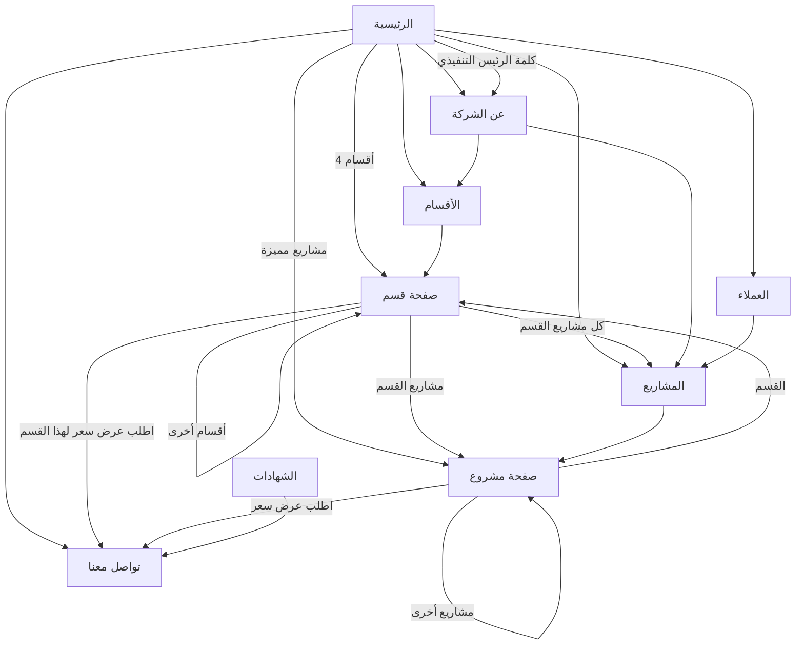

# مخطط موقع دلوك (Site Map)

الموقع بلغتين: كل صفحة موجودة مرتين، بالعربي تحت `/ar/` وبالإنكليزي تحت `/en/`.
المجموع **62 صفحة** (31 صفحة × لغتين)، بالإضافة لـ `404.html` و `sitemap.xml` و `robots.txt`.
زر تبديل اللغة بالهيدر بيوديك على **نفس الصفحة** باللغة التانية.

## شجرة الصفحات

```
/                                   → تحويل تلقائي إلى /ar/
├── /ar/  و  /en/                   الرئيسية
│   ├── about/                      01 عن الشركة (كلمة الرئيس التنفيذي #ceo، الرؤية، الرسالة، القيم، الموارد)
│   ├── services/                   02 الأقسام
│   │   ├── contracting/            قسم المقاولات
│   │   ├── maintenance/            قسم الصيانة والتشغيل
│   │   ├── steel-buildings/        قسم المباني الحديدية
│   │   └── aluminum-facades/       قسم أعمال واجهات الألمنيوم
│   ├── projects/                   03 المشاريع (فلترة حسب الحالة والقسم، ?status= و ?division=)
│   │   ├── office-interior-design/ التصميم الداخلي لمكاتب إدارية (مرحلة التصميم) — معرض صور، مخططات، توزيع المساحات
│   │   ├── rch-al-khobar/          مكاتب RCH — الخبر (مكتمل) — 11 صورة
│   │   ├── akt-head-office/        المقر الرئيسي لشركة AKT (جاري، المباني الحديدية)
│   │   ├── bassam-petroleum/       شركة صالح ومساعد محمد البسام للمعدات البترولية (مكتمل، المباني الحديدية)
│   │   ├── the-wash-club/          ذا واش كلوب (مكتمل)
│   │   ├── akt-car-showroom/       معرض سيارات AKT (جاري) — 10 صور
│   │   ├── salt-khobar/            SALT — الخبر
│   │   ├── fadl-al-yahia-villa/    فيلا فضل اليحيى — الدمام
│   │   ├── 808-square/             مجمع 808 سكوير التجاري — الدمام
│   │   ├── al-hasan-commercial/    مركز الحسن التجاري — الدمام
│   │   ├── snb-branch-69/          البنك الأهلي فرع 69 — الدمام
│   │   ├── snb-branch-41/          البنك الأهلي فرع 41 — القطيف
│   │   ├── ibrahim-villa/          فيلا إبراهيم الإبراهيم — الدمام
│   │   ├── azizia-pool/            مسبح العزيزية — الخبر
│   │   ├── erb-fitout/             تجهيزات ERB الداخلية — الخبر
│   │   ├── moc-theatre/            مسرح وزارة الثقافة — الخبر
│   │   ├── biryanak/               بريانك — الخبر
│   │   ├── sipchem-training/       مركز تدريب سبكيم — الخبر
│   │   ├── bassam-factory/         مصنع البسام (جاري) — الدمام
│   │   └── kawthar-villa/          فيلا الكوثر (جاري) — الدمام
│   ├── clients/                    04 العملاء والشركاء (10 جهات)
│   ├── certificates/               05 الشهادات والاعتمادات (5 وثائق + السجل والرقم الضريبي)
│   └── contact/                    06 تواصل معنا (نموذج → واتساب، ?division= يختار القسم تلقائياً)
└── 404.html                        صفحة "غير موجودة" بلغتين
```

## الترابط بين الصفحات



| الصفحة | بتوصل لـ |
|---|---|
| **كل الصفحات** | الهيدر: الرئيسية، عن الشركة، الأقسام، المشاريع، العملاء، الشهادات، تواصل معنا، اطلب عرض سعر، تبديل اللغة · الفوتر: نفس الروابط + الإيميل، الهاتف، واتساب · زر واتساب العائم · مسار التنقل (Breadcrumbs) بالصفحات الداخلية |
| الرئيسية | الأقسام الأربعة، المشاريع المميزة (6)، كل المشاريع، العملاء، كلمة الرئيس التنفيذي، تواصل معنا |
| عن الشركة | الأقسام، المشاريع |
| الأقسام | صفحات الأقسام الأربعة (مع عدد مشاريع كل قسم) |
| صفحة قسم | 3 مشاريع من القسم، "كل المشاريع" مفلترة على القسم، تواصل معنا (القسم مختار مسبقاً)، الأقسام الأخرى |
| المشاريع | كل صفحات المشاريع، فلترة بالرابط (`?status=ongoing`, `?division=contracting`) |
| صفحة مشروع | صفحة القسم، 3 مشاريع أخرى (من نفس القسم أولاً)، كل المشاريع، تواصل معنا (القسم مختار مسبقاً) |
| العملاء | المشاريع |
| الشهادات | تواصل معنا |
| تواصل معنا | واتساب، إيميل، هاتف، خرائط Google للعنوان |

## السيو (SEO)

- كل صفحة إلها عنوان ووصف خاصين فيها بلغتها، ورابط canonical، وروابط `hreflang` للنسخة باللغة التانية.
- `<html lang dir>` صحيح لكل لغة (`ar`/`rtl` و `en`/`ltr`).
- `sitemap.xml` فيه كل الصفحات الـ 62 مع روابط اللغتين، و `robots.txt` بيدل عليه.
- الدومين المستخدم بالروابط: `https://dolook.sa` — لتغييره: `NEXT_PUBLIC_SITE_URL=https://example.com npm run build`.

## التحقق

`npm run build && npm run check` — بيفحص كل الصفحات: كل رابط داخلي وصورة موجودين، كل صفحة إلها عنوان ووصف و `lang` صحيح و `<h1>` واحد، كل الصور إلها نص بديل، ما في صفحة يتيمة، وكل الصفحات موجودة بالـ sitemap.
